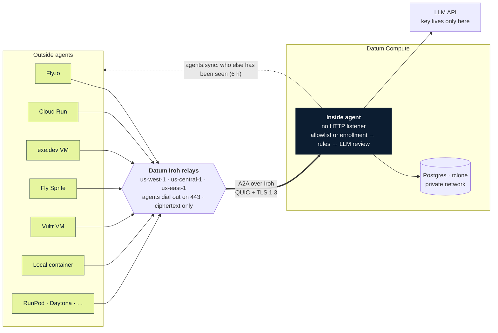

# A2A over Iroh, through Datum

A demo of two agents that talk [A2A](https://github.com/a2aproject/A2A) to each other over an
[Iroh](https://www.iroh.computer/) connection brokered by Datum's Iroh relays. Neither side exposes an HTTP port to the
internet.



Outside agents are satellites of one Datum-hosted inside agent.

- The **inside agent** runs on [Datum Compute](https://www.datum.net/) beside Postgres and an rclone file store. It alone holds
  the LLM key and is the only door to data. It has no HTTP listener.
- An **outside agent** is one binary that runs anywhere with outbound HTTPS (Fly.io, Cloud Run, exe.dev, a laptop). It dials
  the inside agent by public key, asks for IP lookups, LLM answers and reference data, works out where it is hosted, and
  serves a small dashboard.
- Outside agents can enroll themselves with a shared token, so you can add or scale them without touching the inside agent.
- The inside agent remembers every agent seen in the last six hours and each dashboard shows that table, so a platform that
  blocks inbound HTTP still appears on every other agent's page.

```
 Outside agent (Fly / Cloud Run / exe.dev / laptop)                 Datum Compute
 ┌───────────────────────────┐   QUIC, TLS 1.3    ┌────────────────────────────────────┐
 │ iroh endpoint             │  via Datum relays, │ iroh endpoint (stable key)         │
 │ A2A client (HTTP/1.1 over │  direct UDP when   │ A2A server (HTTP/1.1 over streams) │
 │ Iroh streams)             │  hole-punching     │ policy gate: allow/enroll -> rules -> │
 │ dashboard on :8080        │  works             │   LLM review                       │
 │ no LLM key, no other egress│◄─────────────────►│ Postgres · rclone · LLM API        │
 └───────────────────────────┘                    └────────────────────────────────────┘
```

How it works, the security model and the limits: [docs/DESIGN.md](docs/DESIGN.md).

## Layout

| Path | What |
|---|---|
| `crates/a2a-iroh` | Shared library: Iroh endpoints on Datum's relays, A2A over Iroh streams |
| `crates/inside-agent` | Policy gate, LLM broker, data skills, agent registry |
| `crates/outside-agent` | Introspection, agent loop, dashboard (`/`) and about page (`/about`) |
| `deploy/`, `scripts/`, `demo/` | Container files and manifests; build, test, deploy and SBOM helpers; local stack and sample data |
| `docs/` | [DESIGN.md](docs/DESIGN.md) and per-platform [deploy cheat sheets](docs/deploy/README.md) |
| `sbom.md`, `AGENTS.md` | Bill of materials and license audit; orientation for AI coding agents |

## Try it locally

Needs a container runtime and an OpenAI-compatible LLM endpoint (the demo uses [Baseten](https://www.baseten.co/)).

> **A note on containers:** the commands here use `podman` (rootless, because that is how we run it). Anywhere you see Podman,
> Docker or any other compatible container runtime works too; swap the command, and adjust Podman-only flags such as
> `--http-proxy=false`.

```sh
scripts/build.sh                  # builds in a disposable container
export BASETEN_API_KEY=...        # optionally BASETEN_MODEL, BASETEN_BASE_URL
demo/local-stack.sh up            # dashboard at http://127.0.0.1:8088/
demo/local-stack.sh down
```

It still uses Datum's public Iroh relays (override with `RELAYS`).

## Tests

```sh
scripts/test.sh       # unit and tunnel tests, in a container
scripts/fmt.sh        # rustfmt (--check to only report)
scripts/lint.sh       # clippy, warnings are errors
scripts/ui-check.sh   # dashboard in a headless browser with a fake state (after build.sh)
```

A small suite aimed at the security intentions and the tunnel, not at coverage; see [AGENTS.md](AGENTS.md#validating-changes).

## Deploying

See [docs/deploy/](docs/deploy/README.md) for Datum Compute, Fly.io, Cloud Run, exe.dev, Fly Sprites, Vultr, local containers and Railway (untried). Each
outside agent needs its own keypair, whose public id goes on the inside agent's `ALLOWED_PEERS`. Keys, tokens and `.env` are
git-ignored.

A working demo, not a product.

## License & Contributing

[The Unlicense](LICENSE) covers only this project's original code, configuration, documentation and packaging. Third-party
software linked into the executables or bundled in the images keeps its own license.

The Rust crates are mostly **MIT and Apache-2.0**, with BSD, ISC, Zlib, Unicode, CC0 and a few others. Two need a mention:
**MPL-2.0** (`attohttpc`, used unmodified) and **CDLA-Permissive-2.0** (`webpki-roots`, the Mozilla CA data); `ring` carries
BoringSSL-derived notices. The images add Debian (and, for rclone, Alpine) packages under **GPL, LGPL, MPL-2.0** and others;
those apply to the packages, not to this code. Postgres is pulled unmodified at deploy time. The dashboard borrows a palette
from datum.net but bundles none of its fonts or artwork; Datum's name and branding are not covered by The Unlicense.

[`sbom.md`](sbom.md) has exact versions and license evidence, and [`scripts/generate-sbom.py`](scripts/generate-sbom.py)
regenerates it. Keep upstream notices when redistributing built binaries or images; the published images do not yet bundle them.

This project is "vibe-coded". Instead of accepting contributions, the author encourages you to fork it or build your own.
Requests will be accommodated when possible.
