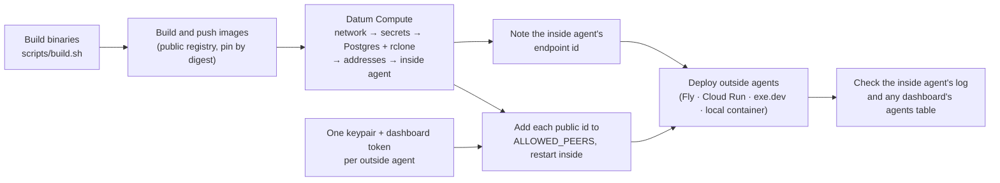
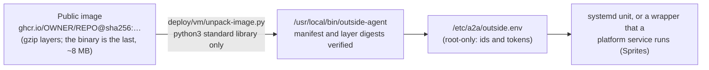
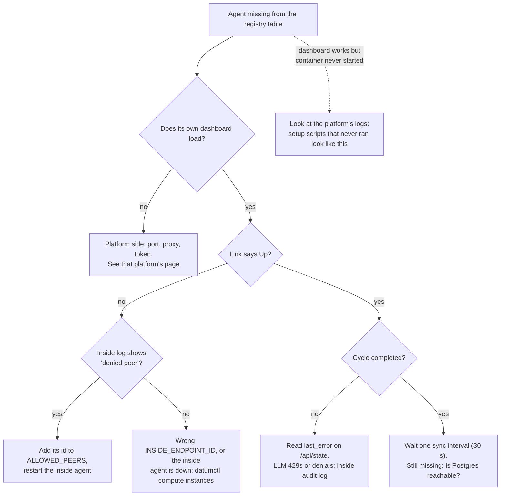

# Deploy cheat sheets

Field notes from doing it: exact steps, what to check, what went wrong, how to tear down. Commands marked *not run here* are
standard tooling we did not exercise. Commands use `podman`, which can mean Docker or any compatible container runtime
([details](../../README.md#try-it-locally)).

| Page | Runs | Status |
|---|---|---|
| [Datum Compute](datum-compute.md) | Inside agent, Postgres, rclone | Deployed, repeatedly |
| [Fly.io Apps](fly-io.md) | Outside agent | Deployed, verified |
| [Fly Sprites](fly-sprites.md) | Outside agent | Deployed, verified (sleeps when idle) |
| [Vultr](vultr.md) | Outside agent | Deployed, verified (billed hourly) |
| [Cloud Run](cloud-run.md) | Outside agent | Deployed, verified |
| [exe.dev](exe-dev.md) | Outside agent | Deployed, verified |
| [Local containers](local-containers.md) | Outside agent, or everything | Deployed, verified |
| [Railway](railway.md) | Outside agent | **Not deployed** (Railway outage) |

## The order of things



## Common steps

**1. Build** (no Rust toolchain needed on the host): `scripts/build.sh`. Binaries land in the `a2a-target` volume.

**2. Build and push images.** Every platform runs the same Containerfiles in `deploy/`.

```sh
mkdir -p .local-stack/bin
podman run --rm --http-proxy=false -v a2a-target:/t:ro,z -v "$PWD/.local-stack/bin":/out:z \
  docker.io/library/debian:bookworm-slim sh -c 'cp /t/release/inside-agent /t/release/outside-agent /out/'
podman build -t ghcr.io/OWNER/REPO:inside  -f deploy/Containerfile.inside  .local-stack/bin
podman build -t ghcr.io/OWNER/REPO:outside -f deploy/Containerfile.outside .local-stack/bin
podman build -t ghcr.io/OWNER/REPO:rclone  -f deploy/Containerfile.rclone  .
podman push ghcr.io/OWNER/REPO:inside --digestfile /tmp/inside.digest     # likewise outside and rclone
```

Platforms pull by digest (`@sha256:…`), which pins exactly what runs. exe.dev needs a **public** image, and GitHub has no API
for that: flip the package in its settings once.

**3. Choose how outside agents are admitted.** Either works; they can be mixed.

- **Enrollment token (best for scaling).** One shared token: `head -c 18 /dev/urandom | base64 | tr -d '/+=' > keys/enrollment.token`.
  The inside agent gets it as `ENROLLMENT_TOKEN`, and each outside agent as `ENROLLMENT_TOKEN` too, with **no key set**. It
  generates a fresh identity at every start and enrolls itself, so adding agents never touches the inside agent. This is what
  `demo/local-stack.sh` does. The Fly, Cloud Run and exe.dev scripts still use pre-registered keys; switching one to a token is
  an environment swap (`ENROLLMENT_TOKEN` instead of `OUTSIDE_SECRET_KEY_HEX`) that we have not run on those platforms.
- **Keypair per agent.** Generate one, keep it in git-ignored `keys/` as `NAME.key` (secret) and `NAME.id` (public id), and
  allowlist the id in step 4:

```sh
podman run --rm --http-proxy=false -v "$PWD/.local-stack/bin":/i:ro,z docker.io/library/debian:bookworm-slim \
  /i/outside-agent keygen          # prints SECRET=<hex> and ENDPOINT_ID=<hex>; inside-agent keygen makes the inside key
python3 -c "import secrets; print(secrets.token_urlsafe(18))" > keys/fly.token
```

Either way, each outside agent also wants a dashboard token (`NAME.token`) if its dashboard is public.

**4. Tell the inside agent** the enrollment token and/or the ids of keyed agents, then restart it
([how](datum-compute.md#allow-agents)).

**5. Verify.** Look for the agent in the inside log, and in the **Agents the inside agent has seen** table on any dashboard,
usually within a minute. That table is the best check for platforms that block inbound HTTP: read it from a different agent.

```sh
datumctl compute logs a2a-inside | grep -E 'peer (connected|disconnected)|denied peer'
```

## VM targets: unpacking the image

Container platforms run our image. Plain VMs (Vultr, Fly Sprites, any Linux box) have no container runtime, but the agent is a
single binary in the image's last layer, so the VM targets **unpack** the image instead:



`deploy/vm/install-outside-agent.sh` does the rest (settings file, service) and re-runs itself under `sudo` if needed. The image must
be public and pinned by digest; a pinned reference is verified end to end. VM targets want an **enrollment token** or a key file, never
a Datum-only secret. Test the unpacker with `python3 -m unittest discover -s deploy/vm`.

## When an agent does not show up



## Gotchas on every platform

- Podman copies the host's `http_proxy` into containers: pass `--http-proxy=false` (a Podman flag; with Docker, check your proxy settings instead).
- Never `source` the `.env`: values like Fly's `FlyV1 …` token contain spaces, and bash runs (and echoes) them. Parse the file.
- Give each step a few seconds before the next; Datum in particular pushes back on rapid applies.
