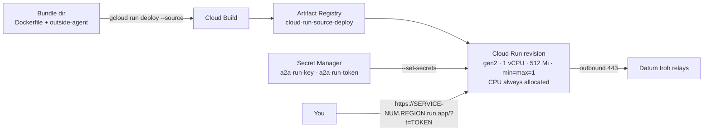

# Cloud Run: outside agent

The agent runs background loops, which Cloud Run is not built for, so it is deployed with **CPU always allocated** and **exactly
one instance**. Expect roughly $1.5–2 a day while it runs; tear it down when done.



## Prerequisites

- `gcloud`, logged in. It may not be on `PATH` in non-login shells.
- **Pass `--project` explicitly**: our account had no default project, and `gcloud config set` is global state.
- Billing enabled, and the APIs on:

```sh
export P=your-project
for api in run artifactregistry cloudbuild secretmanager; do gcloud services enable $api.googleapis.com --project $P; sleep 6; done
```

## Secrets

Keep the key and token in Secret Manager; plain environment variables are readable by anyone with project view access.

```sh
printf %s "$(cat keys/run.key)"   | gcloud secrets create a2a-run-key   --project $P --replication-policy=automatic --data-file=-
printf %s "$(cat keys/run.token)" | gcloud secrets create a2a-run-token --project $P --replication-policy=automatic --data-file=-
SA=$(gcloud projects describe $P --format='value(projectNumber)')-compute@developer.gserviceaccount.com
for s in a2a-run-key a2a-run-token; do
  gcloud secrets add-iam-policy-binding $s --project $P --member="serviceAccount:$SA" --role=roles/secretmanager.secretAccessor
done
```

Use `printf %s`, not `--data-file=<file>`: a trailing newline gets stored, and the stored token then never matches. (The agent
trims its token now, but don't rely on that.) The default compute account built from source fine here (it had `roles/editor`); a
stricter project may need `roles/cloudbuild.builds.builder` for it.

## Deploy

```sh
mkdir -p /tmp/run-bundle && cp deploy/Containerfile.outside /tmp/run-bundle/Dockerfile && cp .local-stack/bin/outside-agent /tmp/run-bundle/
GCP_PROJECT=$P BUNDLE=/tmp/run-bundle deploy/cloudrun/deploy.sh
```

About four minutes the first time (it also creates the `cloud-run-source-deploy` Artifact Registry repo). The script sets gen2,
`--no-cpu-throttling`, min and max instances of 1, 1 vCPU, 512 Mi, `--allow-unauthenticated` (the dashboard token is the gate),
`INSIDE_ENDPOINT_ID` as an env var and the two secrets mounted. It prints the service URL.

## Check

```sh
curl -s -o /dev/null -w '%{http_code}\n' "https://SERVICE-URL/?t=$(cat keys/run.token)"      # 200
curl -s "https://SERVICE-URL/api/state?t=$(cat keys/run.token)" | head -c 300
```

## Quirks

- **Use `?t=`, not a bearer header.** Google's front end treats any `Authorization: Bearer …` as a Google identity token and
  answers 401 before the request reaches the agent. The query token sets a cookie for later requests.
- **`/healthz` is 404**: Google reserves it. Check `/` with the token.
- **The public IP can arrive late**, so a first-cycle row may lack an ASN and city; the next cycle fills it in.
- **It looks odd from inside**: hostname `localhost`, a 6.9 kernel, `169.254.x.x` interfaces. `K_SERVICE` and `K_CONFIGURATION`
  are what identify it. Egress IPs change between revisions, so don't allowlist by IP.

## Tear down (*not run here*)

```sh
gcloud run services delete a2a-outside --project $P --region us-west1 --quiet
gcloud secrets delete a2a-run-key   --project $P --quiet
gcloud secrets delete a2a-run-token --project $P --quiet
gcloud artifacts repositories delete cloud-run-source-deploy --project $P --location us-west1 --quiet
```
