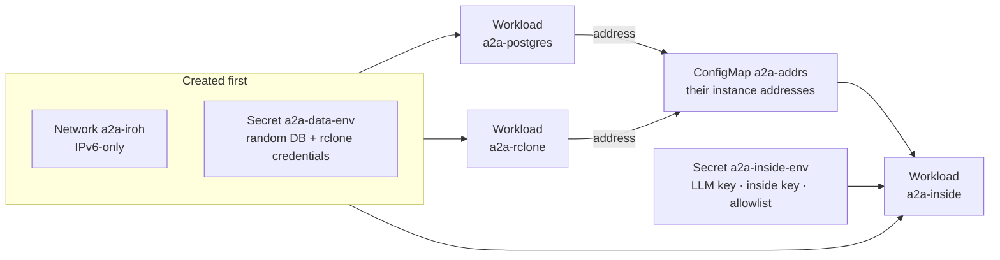

# Datum Compute: inside agent, Postgres, rclone

All three run on one dedicated network with **nothing exposed over HTTP**: no `NetworkService` publishes the inside agent and
there is no `HTTPProxy` or load balancer. Outside agents reach it only by dialing its Iroh endpoint id. Manifests are in
`deploy/datum/`; `datumctl` must be on your `PATH` (or run from a container).

## What depends on what



There is no private DNS yet, so the inside agent finds Postgres and rclone through a ConfigMap of their instance addresses,
which is why the order below matters.

## Deploy

First put your image digests in `deploy/datum/{inside,rclone}.yaml` ([how](README.md#common-steps)). The manifests also name an
`imagePullSecrets` entry `registry-credentials`: create it for a private registry, or try removing it for public images (*not run here*).

```sh
datumctl apply -f deploy/datum/network.yaml                      # 1. a dedicated network, not "default"
sleep 8
python3 deploy/datum/data-secret.py | datumctl apply -f -        # 2. random DB and rclone credentials (re-running rotates them)
python3 deploy/datum/inside-secret.py LLM.env keys/inside.key "$(cat keys/fly.id),$(cat keys/exe.id)" | datumctl apply -f -
sleep 5
datumctl apply -f deploy/datum/postgres.yaml                     # 3. Postgres (ephemeral disk)
datumctl apply -f deploy/datum/rclone.yaml                       #    rclone (read-only WebDAV of demo/rclone-data)
datumctl compute workloads                                       #    wait until both are Available
sleep 20
deploy/datum/addrs.sh | datumctl apply -f -                      # 4. ConfigMap of their IPv6 addresses
datumctl apply -f deploy/datum/inside.yaml                       # 5. the inside agent
datumctl compute logs a2a-inside | grep -E 'ENDPOINT_ID|postgres ready|allowlist'
```

`LLM.env` needs `BASETEN_API_KEY` and `BASETEN_MODEL`; the quoted argument is the comma-separated allowlist of outside-agent
ids. The logged `ENDPOINT_ID=…` is what every outside agent needs as `INSIDE_ENDPOINT_ID`. It is **stable** (the key is in a
Secret), so it survives restarts and redeploys. `addrs.sh` printing "no instance" means a workload is not Available yet.

## Allowlist an agent

```sh
python3 deploy/datum/inside-secret.py LLM.env keys/inside.key "$ID1,$ID2,$ID3" | datumctl apply -f -
datumctl compute restart a2a-inside            # instances do not notice Secret or ConfigMap changes on their own
datumctl compute logs a2a-inside | grep allowlist     # "allowlist: 3 peer(s)"
```

To update the agent, push an image, put its digest in `inside.yaml` and apply: a rolling update, same endpoint id.

## Look inside

```sh
datumctl compute instances                         # names, addresses, status
datumctl compute logs a2a-inside                   # audit lines: {"audit":{"peer","skill","decision","reason"}}
datumctl compute exec a2a-postgres-us-west-us-west-1-0 -- sh -c \
  'psql -U "$POSTGRES_USER" -d "$POSTGRES_DB" -c "select skill, decision, count(*) from agent_audit group by 1,2"'
```

`exec` wants the **instance** name from `compute instances`, not the workload name.

## What went wrong

- **"Your request took too long to be checked against your quota"** on apply or restart: a platform-side timeout. Retry after a pause.
- **An instance stuck at `Pending (NetworkFailedToCreate)`** (the same timeout, hitting IPv6 allocation). A rolling restart did not
  help; `datumctl compute destroy a2a-inside` and re-applying did, with the endpoint id unchanged.
- **Postgres is ephemeral.** Redeploying it loses the registry and audit tables; the inside agent re-seeds reference data and
  retries until the database is up, so apply order is forgiving.
- **IPv6 only.** Outbound HTTPS to dual-stack hosts (the LLM API, IP lookup, relays) works.
- **Stale ConfigMap.** A replaced Postgres or rclone can get a new address: re-run `addrs.sh`, apply, restart the inside agent.

## Tear down

```sh
for w in a2a-inside a2a-postgres a2a-rclone; do datumctl compute destroy $w; sleep 3; done
datumctl get networkservices                         # delete any a2a-* left over: datumctl delete networkservice NAME
datumctl delete secret a2a-data-env a2a-inside-env
datumctl delete configmap a2a-addrs
datumctl delete network a2a-iroh                     # last, and only ours
```

Look at each target first; the project may hold other networks and workloads.
