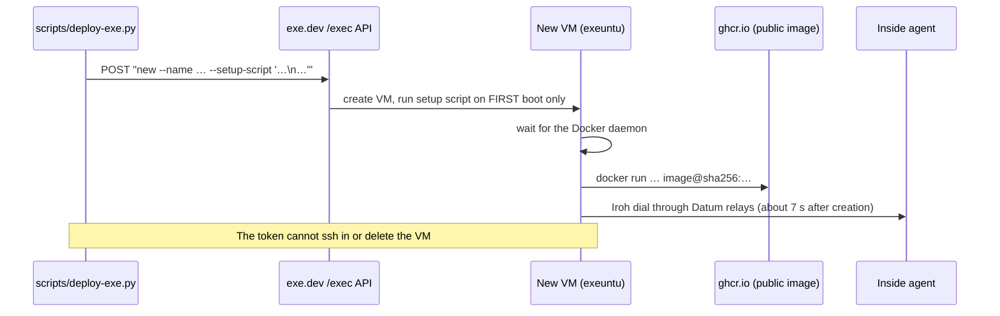

# exe.dev: outside agent

exe.dev gives you a persistent VM with Docker behind an HTTPS proxy, created through one HTTPS API. The agent runs as a Docker
container started by the VM's **first-boot setup script**. It is the platform that most restricts inbound HTTP, so it is the
best demo of the agents registry: the agent works, and shows on other agents' pages, even if you never open its own.



## What the API token can do

The `exe1.…` token is a bearer token for `POST https://exe.dev/exec`, whose body is the command you would type after
`ssh exe.dev`. By default it can run `new`, `ls`, `whoami`, `share show` and a few read-only commands. It **cannot** `rm`, `ssh`,
`share set-public` or `share port`, so it can neither delete a test VM nor look inside one. Create few VMs, and get the setup
script right. `new --help` is a safe way to explore. Limits: 30 s, 64 KB.

## Before you run it

- The VM must be able to pull the image: use a **public** ghcr package (`ghcr.io/OWNER/REPO@sha256:…`). `new --registry-auth`
  covers a VM's *boot* image, not a `docker run` inside it, and a private image would need a login in the setup script (not
  tried). Making the package public was simpler; the image holds no secrets.
- `.env` with `EXEDEV`, `keys/exe.key`, `keys/exe.token`, `keys/inside.id`; the agent's id on the inside allowlist.

## Deploy

```sh
python3 scripts/deploy-exe.py sha256:<outside image digest> 80 a2a-outside
#                                                           ^ host port  ^ VM name (must be unique)
```

It sends `new --name=… --no-email --json --setup-script='…'`; the script waits for Docker, then runs `docker run -d --restart=always
-p PORT:8080 -e OUTSIDE_SECRET_KEY_HEX=… -e INSIDE_ENDPOINT_ID=… -e DASHBOARD_TOKEN=… image@digest`. Within seconds the inside log
shows `peer connected: <the exe id>`.

## The dashboard

exe.dev's proxy sends traffic to **port 8000 by default** and starts **private** (you, signed in). So either publish on 8000, or
point the proxy at your port with your own SSH access (not the API token):

```sh
ssh exe.dev share port a2a-outside 80
ssh exe.dev share set-public a2a-outside       # optional; the dashboard token still gates it
```

We used 80 because it was known to bind; whether 8000 is free on the VM image is unconfirmed.

## Check and debug

```sh
datumctl compute logs a2a-inside | grep "peer connected"
ssh a2a-outside.exe.xyz                        # then:  sudo docker ps -a;  sudo docker logs a2a-outside
```

**An empty `docker ps -a` means the setup script never ran**; the agent is not the problem.

## What went wrong

- **The setup script ran as one garbled line.** Our script escaped newlines as `\\n` (two backslashes) instead of `\n`, so the VM got
  literal `\n` text and never ran `docker run`. Two VMs sat `running` with no container. In Python it is
  `script.replace("\n", "\\n")`. The command line passes through more than one parser, so check the wire format when something
  looks right but does not run.
- **The script runs on first boot only.** A fixed script needs a new VM, and the old one needs `ssh exe.dev rm NAME`.
- **The dashboard redirected to an exe.dev login.** That is the private default; the agent was healthy.

## Tear down

```sh
ssh exe.dev rm a2a-outside            # needs your SSH access; the API token cannot delete VMs
```
