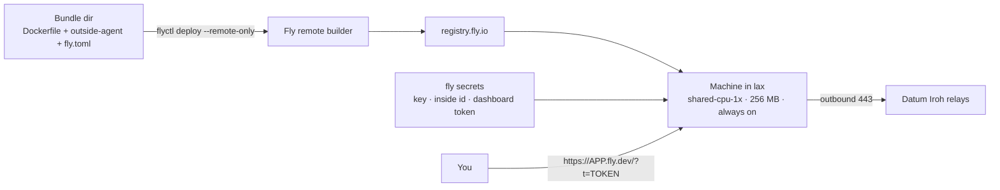

# Fly.io: outside agent

One always-on shared-CPU machine with a public HTTPS URL. Fly **builds the image remotely** from a tiny bundle (a Dockerfile and
the prebuilt binary), so no registry is involved, and `flyctl` runs in a container.



## Before you run it

`scripts/deploy-fly.sh` is tied to one account's names. Change:

- `APP=` in the script and `app =` in `deploy/fly/fly.toml`: the name must be **globally unique** (it becomes `APP.fly.dev`);
- `--org personal` if your org slug differs, and `primary_region` if you want somewhere other than `lax`.

You need `.env` with `FLYIO_TOKEN`, and `keys/fly.key`, `keys/fly.token`, `keys/inside.id`. The Fly token is `FlyV1 fm2_…`
**with a space**, so the `.env` must be parsed, never `source`d.

## Deploy

```sh
BIN=.local-stack/bin/outside-agent scripts/deploy-fly.sh
```

About two minutes. It creates the app, imports the secrets from a temp file (`flyctl secrets import --stage`, so none appears on a
command line), deploys with `--remote-only --ha=false`, and prints `https://APP.fly.dev/?t=<keys/fly.token>`.

In `fly.toml`, `auto_stop_machines = "off"` and `min_machines_running = 1` matter because the agent runs background loops and must
not idle-stop. The health check uses `/healthz`, the one path the token gate leaves open.

## Check

```sh
flyctl status -a APP                                                               # started, 1 check passing
curl -s -o /dev/null -w '%{http_code}\n' https://APP.fly.dev/                      # 401 without the token
curl -s -H "Authorization: Bearer $(cat keys/fly.token)" https://APP.fly.dev/api/state | head -c 300
```

The bearer form works here because Fly passes `Authorization` through (Cloud Run does not). The hosting guess should name Fly.io,
citing the `FLY_*` variables, the `…-fly` kernel and the `fdaa::/16` private address.

## What went wrong

- `flyctl` in a container fails with `$HOME is not defined`: pass `-e HOME=/tmp`.
- Sourcing `.env` ran half the token as a command and echoed it. The script parses the file instead.

## Tear down

```sh
flyctl apps destroy APP -y       # removes the machine, secrets and app name
```
