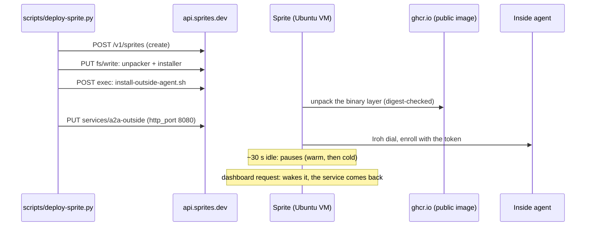

# Fly Sprites: outside agent

A Sprite is a persistent Linux VM (Ubuntu) that Fly pauses when idle and wakes on demand. It is a different product from a Fly
App (see [Fly.io Apps](fly-io.md)): no Dockerfile, no registry, no container runtime. `scripts/deploy-sprite.py` therefore
**unpacks our image** onto the VM ([how](README.md#vm-targets-unpacking-the-image)) and defines the agent as a Sprite service.



## Before you run it

- `SPRITE_TOKEN` in `.env`: create one at sprites.dev/account. **The Fly token used for Fly Apps does not work** here (401).
- The image must be **public** and pinned by digest, and the inside agent needs an enrollment token (or a pre-registered key).

## Deploy

```sh
scripts/deploy-sprite.py up --image ghcr.io/OWNER/REPO@sha256:<outside digest> \
  --inside-id keys/inside.id --enrollment-token-file keys/enrollment.token
scripts/deploy-sprite.py down        # deletes the sprite
```

It creates the sprite, copies in the two helper files, runs the installer, and defines the service. Settings travel as environment
variables of that one exec call and end up in a root-only `/etc/a2a/outside.env`. The installer notices it is not root and
re-runs itself under `sudo`; without systemd it leaves a wrapper, `/usr/local/bin/a2a-outside-run`, which the service runs.

Options: `--keep-awake` (below), `--name`, and `--public-url` (needs `--dashboard-token-file`: the dashboard shows runtime facts).

## Sleeping, and what it does to an agent

About 30 seconds after going idle a Sprite pauses: **warm** (VM frozen, open connections dropped) and later **cold** (stopped).
Compute is free while paused. For our agent that means it shows as **live in the registry only while the Sprite is awake**, and
goes stale otherwise. A request to the dashboard URL wakes it, and the service resumes or restarts.

`--keep-awake` adds a second service that renews a 5-minute hold through the documented Tasks API every minute, so the agent
stays live. The Sprite then bills continuously (documented CPU and memory rates, per second). *Not run here.*

## Check

```sh
# The dashboard URL (printed by `up`) is private: it wants your Sprites token, and without it returns a sign-in page with HTTP 200.
curl -s -H "Authorization: Bearer $SPRITE_TOKEN" https://NAME-ID.sprites.app/api/state | head -c 300
```

Better: look for the agent in another agent's registry table. What a Sprite reports about itself: Ubuntu 26.04, a `…-fly` kernel,
8 CPUs and 16 GB, a non-root user, interface `spr0` at `10.0.0.1`, and an `SPRITE_*` environment variable, which the agent uses as its
platform hint ("Fly Sprite").

## What we learned

- `200` from the Sprite URL is not proof the agent answered: unauthenticated requests get Sprites' sign-in page.
- Services do not stop a Sprite pausing; a service that handles HTTP counts as activity only while a request is in flight.
- The `fs/write` endpoint caps files at 16 MiB, fine for the helpers (the 24 MB binary is unpacked on the Sprite, not uploaded).
