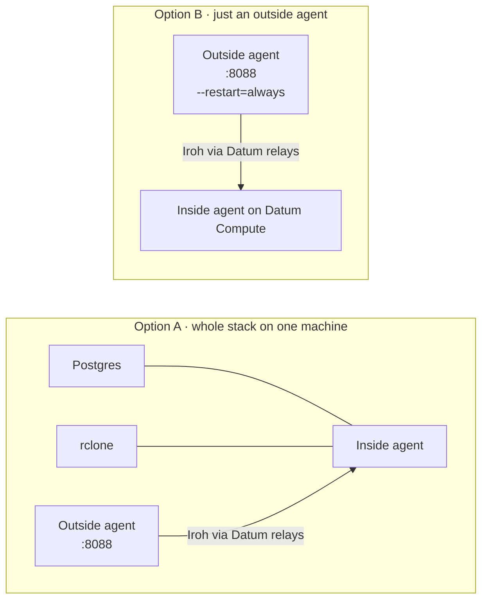

# Local containers

Two ways to run locally in containers, using the same images as everywhere else. Commands use `podman`; Docker or any
compatible runtime works too (rootless is just how we run it, not a requirement).



## A. The whole stack

```sh
scripts/build.sh
export BASETEN_API_KEY=...            # optionally BASETEN_MODEL, BASETEN_BASE_URL, RELAYS, PORT
demo/local-stack.sh up                # Postgres, rclone, inside agent and outside agent on separate networks
demo/local-stack.sh down
```

The inside agent's key and an enrollment token are made once in git-ignored `.local-stack/`, so its endpoint id is stable between
runs. Outside agents have no keys: they enroll themselves with the token. Add more while it runs, without restarting anything:

```sh
demo/local-stack.sh add          # another outside agent, dashboard on a free port
```

It still uses Datum's public relays unless you set `RELAYS`. Set `PORT` if 8088 is taken.

## B. Just an outside agent, long-lived, talking to a deployed inside agent

```sh
podman run -d --name a2a-outside --restart=always --http-proxy=false -p 8088:8080 \
  -v "$PWD/keys/outside.key:/keys/outside.key:ro,z" -e OUTSIDE_KEY_FILE=/keys/outside.key \
  -e INSIDE_ENDPOINT_ID="$(cat keys/inside.id)" IMAGE      # e.g. localhost/a2a-outside:local from deploy/Containerfile.outside
```

Add `-e DASHBOARD_TOKEN=…` if others can reach the host's port; without it the dashboard is open to your LAN. To survive reboots with Podman, enable
`podman-restart.service` for your user (`systemctl --user enable podman-restart.service`, with lingering on); Docker's daemon restarts
containers itself.

## Gotchas

- Use `http://127.0.0.1:8088`: `localhost` resolved to IPv6 first and the published port did not answer there.
- On our host (rootless Podman) networking is `pasta`, which copies the **host's** addresses into the container, so there is no
  separate container IP and the agent's hosting guess says "home machine". Other runtimes will show other addresses.
- `--http-proxy=false` (Podman) and `:z` on mounts (SELinux hosts only): see [the common gotchas](README.md#gotchas-on-every-platform).

## Tear down

```sh
demo/local-stack.sh down            # A
podman rm -f a2a-outside            # B
```
