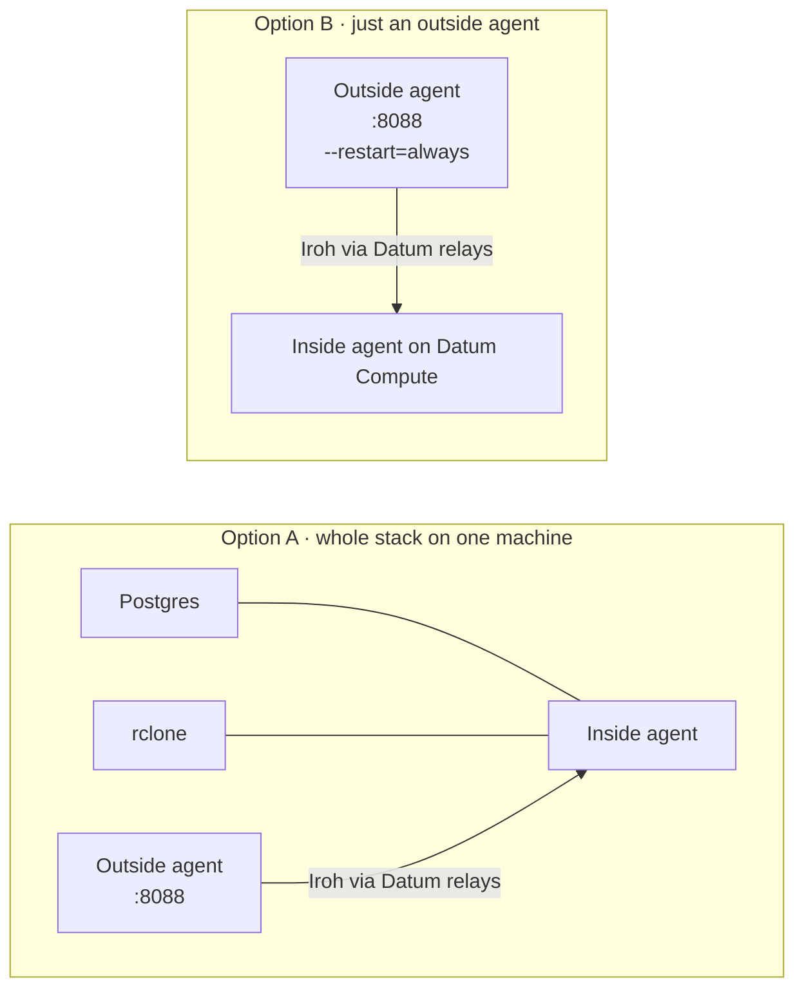

# Local Podman

Two ways to run locally, both with rootless Podman and the same images as everywhere else.



## A. The whole stack

```sh
scripts/build.sh
export BASETEN_API_KEY=...            # optionally BASETEN_MODEL, BASETEN_BASE_URL, RELAYS, PORT
demo/local-stack.sh up                # Postgres, rclone, inside agent and outside agent on separate networks
demo/local-stack.sh down
```

Keys are generated once into git-ignored `.local-stack/`, so the agents keep their identities between runs. It still uses Datum's
public relays unless you set `RELAYS`. Set `PORT` if 8088 is taken.

## B. Just an outside agent, long-lived, talking to a deployed inside agent

```sh
podman run -d --name a2a-outside --restart=always --http-proxy=false -p 8088:8080 \
  -v "$PWD/keys/outside.key:/keys/outside.key:ro,z" -e OUTSIDE_KEY_FILE=/keys/outside.key \
  -e INSIDE_ENDPOINT_ID="$(cat keys/inside.id)" IMAGE      # e.g. localhost/a2a-outside:local from deploy/Containerfile.outside
```

Add `-e DASHBOARD_TOKEN=…` if others can reach the host's port; without it the dashboard is open to your LAN. To survive reboots,
enable `systemctl --user enable podman-restart.service` (with lingering on).

## Gotchas

- Use `http://127.0.0.1:8088`: `localhost` resolved to IPv6 first and the published port did not answer there.
- Rootless networking here is `pasta`, which copies the **host's** addresses into the container. There is no separate container
  IP, and the agent's hosting guess says "home machine" accordingly.
- `--http-proxy=false` and `:z` on mounts: see [the common gotchas](README.md#gotchas-on-every-platform).

## Tear down

```sh
demo/local-stack.sh down            # A
podman rm -f a2a-outside            # B
```
