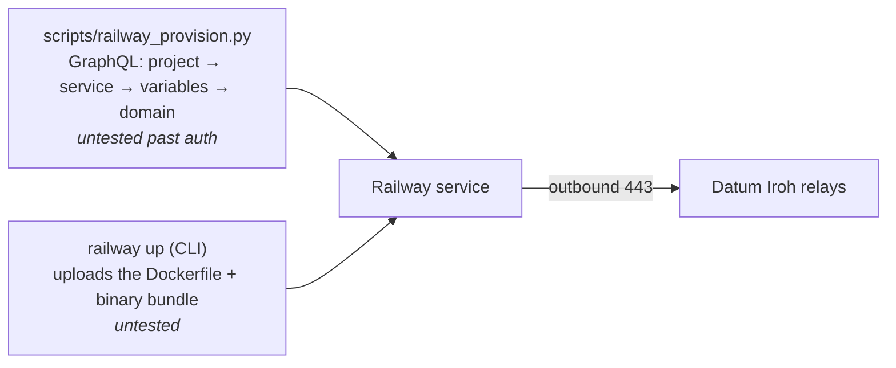

# Railway: outside agent (not deployed)

**Never completed.** Railway was in a platform-wide outage ("API unavailable, builds paused") and project creation returned
`Deploys have been paused temporarily`. What is below is the plan and a script that ran no further than authentication.
Expect to fix things, and please update this page with what actually happened.

Verified:

- Our token is an **account** token: `Authorization: Bearer …` works against `https://backboard.railway.com/graphql/v2`.
- Python's default `User-Agent` got HTTP 403 at their edge; send an explicit one.
- The workspace was on the Hobby plan with billing `INACTIVE`, which may block deploys even when the platform is healthy.

## Plan

1. `python3 scripts/railway_provision.py` (reads `RAILWAY_TOKEN` from `.env`) creates the project and service, sets
   `OUTSIDE_SECRET_KEY_HEX`, `INSIDE_ENDPOINT_ID`, `DASHBOARD_TOKEN`, `PORT=8080` and `REFRESH_SECS`, and a public domain on 8080.
2. Deploy the same bundle as Fly and Cloud Run (Dockerfile + `outside-agent`) with the Railway CLI, which we ran from a Node
   container: `railway up --detach --project <id> --environment <id> --service <id>` with `RAILWAY_API_TOKEN` set.

The agent already honors Railway's `PORT` and recognizes `RAILWAY_*` variables.
