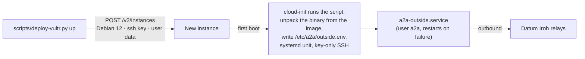

# Vultr: outside agent

A Vultr cloud instance is a plain VM: no container runtime and no platform environment variables. `scripts/deploy-vultr.py`
creates one from the API whose first-boot script (cloud-init user data) **unpacks our image** and runs the agent under systemd
([how](README.md#vm-targets-unpacking-the-image)). The cheapest plan is about $3.50 a month.



## Status: deployed and verified

Created, verified and deleted live. The agent enrolled and went live in the registry about two minutes after creation; the unit ran
as the unprivileged `a2a` user with `Restart=always`; the settings file was root-only; SSH was key-only; the dashboard was on localhost
only; and the whole VM used about 120 of 451 MB. The instance's DMI reads `sys_vendor: Vultr`, `product_name: VC2`, which the agent
uses as its platform hint. `down` removed the instance and its SSH key and nothing else.

**API access list.** Vultr API keys have an IP access list, and calls from an unlisted address return `401 Unauthorized IP address`
(the same through `vultr-cli`: it is enforced by Vultr, not the client). Add the machine under Account, API, **Access Control**.

## Deploy

```sh
scripts/deploy-vultr.py up --image ghcr.io/OWNER/REPO@sha256:<outside digest> \
  --inside-id keys/inside.id --enrollment-token-file keys/enrollment.token
scripts/deploy-vultr.py up --dry-run ...            # build everything, call nothing (--user-data-out FILE to inspect it)
scripts/deploy-vultr.py down                        # deletes the instance and its SSH key
```

Needs `VULTR` in `.env`. Defaults: region `ewr` (the $3.50 `vc2-1c-0.5gb` plan is offered only there), Debian 12; `--plan vc2-1c-1gb`
($5) works in most regions, for example `--region lax`. The script makes a throwaway SSH key in `keys/vultr_ed25519`, registers it,
and turns password logins off in the first-boot script. Polling waits up to 10 minutes for the instance to be active.

## Reaching it

The dashboard listens on **localhost only**, because Vultr instances are public and plain HTTP would send the dashboard token in
the clear. The agent shows up in other agents' registry tables regardless, which is the point. To look at it:

```sh
ssh -i keys/vultr_ed25519 root@IP -L 8080:localhost:8080      # then open http://localhost:8080/
ssh -i keys/vultr_ed25519 root@IP journalctl -u a2a-outside
```

## Billing

Plans have an **hourly** rate next to the monthly price (from Vultr's plan data: `vc2-1c-0.5gb` is $0.005/hour or $3.50/month,
`vc2-1c-1gb` is $0.007/hour or $5/month). Charges accrue while the instance exists, so a short test costs fractions of a cent;
delete it with `down` when done. We could not fetch Vultr's billing page to confirm how the monthly cap and powered-off instances
are handled, so treat "stopped is still billed until destroyed" as the safe assumption. `up` refuses to create a second instance
with the same label, so only one runs at a time.

## Notes

- The settings, including the enrollment token, are in the instance's user data, which Vultr keeps and the account owner can read.
- Vultr sets a root password by default; it is returned by the API once, never used here, and SSH password login is disabled.
- Our agent needs about 20 MB of memory, so even the 512 MB plan is plenty without Docker.
